# Laboratory Report: Algorithms for Intelligent Systems and Robotics (CSAI4014)

**Student Name:** Himanshu Pokhriyal
**Roll No.:** 500121200
**Batch:** B.Tech CSE (AI & ML), Semester VII
**Course Teacher:** Dr. Resham Raj Shivwanshi
**University:** University of Petroleum and Energy Studies (UPES), Dehradun
**Academic Year:** Autumn Semester 2026-27
**Date of Submission:** 23 November 2026

---

## Declaration

I hereby declare that this laboratory report is the result of my own work. All code was written and executed by me on my own machine. Sources consulted and AI tools used are listed in Appendix B. Every figure and number in this report was produced by running the experiment it illustrates.

---

## Index

1. Experiment 1: Time and frequency domain, and the pendulum
2. Experiment 2: The eight queens problem
3. Experiment 3: Breadth-first and depth-first search
4. Experiment 4: Hill climbing
5. Experiment 5: Reinforcement learning
6. Experiment 6: A simple neural network
7. Experiment 7: Webots: Reactive swarm and Lidar navigation
8. Experiment 8: Cross-embodiment transfer in PyBullet
- Appendix A: GitHub repository
- Appendix B: Sources and AI tools used

---

## List of Figures

- Fig. 1.1 Time-domain signal (Exp 1)
- Fig. 1.2 Amplitude spectrum (Exp 1)
- Fig. 1.3 Aliasing (Exp 1)
- Fig. 1.4 Damping (Exp 1)
- Fig. 1.5 Phase portrait and period vs amplitude (Exp 1)
- Fig. 2.1 Scaling of queens solvers (Exp 2)
- Fig. 2.2 First solution board (Exp 2)
- Fig. 3.1 Maze search comparison (Exp 3)
- Fig. 4.1 Landscape with local maxima (Exp 4)
- Fig. 4.2 Success rate vs restarts (Exp 4)
- Fig. 5.1 Q-learning return vs episode (Exp 5)
- Fig. 6.1 XOR training loss (Exp 6)
- Fig. 6.2 Decision boundary (Exp 6)
- Fig. 7.1 Swarm trajectories and coverage (Exp 7)
- Fig. 7.2 Pioneer default path (Exp 7)
- Fig. 7.3 Swarm at cruise 0.9 (Exp 7)
- Fig. 7.4 Pioneer bubble 0.15 (Exp 7)
- Fig. 8.1 Workspace (Exp 8)
- Fig. 8.2 Joint-space replay paths (Exp 8)
- Fig. 8.3 Task-space transfer paths (Exp 8)
- Fig. 8.4 Learn once deploy many (Exp 8)
- Fig. 8.5 Multi-embodiment training (Exp 8)

## List of Tables

- Table 1.1 Spectrum of constructed signal (Exp 1)
- Table 1.2 Period vs amplitude (Exp 1)
- Table 2.1 Scaling of queens (Exp 2)
- Table 3.1 Maze search (Exp 3)
- Table 4.1 Success rate vs restarts (Exp 4)
- Table 5.1 Mean return vs epsilon (Exp 5)
- Table 6.1 Final MSE vs learning rate (Exp 6)
- Table 7.1 Swarm metrics (Exp 7)
- Table 7.2 Pioneer metrics (Exp 7)
- Table 8.1 Embodiments (Exp 8)
- Table 8.2 Joint-space replay (Exp 8)
- Table 8.3 Task-space transfer (Exp 8)
- Table 8.4 Learn once deploy many (Exp 8)
- Table 8.5 Leave-one-embodiment-out (Exp 8)

---


# Experiment 1: Time and frequency domain, and the pendulum

## 1.1 Aim

To represent a sampled signal in the time domain and in the frequency domain using the discrete Fourier transform, and to simulate the motion of a simple pendulum by numerical integration of its equation of motion.

## 1.2 Objectives

1. Generate a sampled signal of known composition and state its sampling rate, record length and frequency resolution.
2. Compute an amplitude spectrum and read amplitudes from it in the units of the original signal.
3. Predict and then demonstrate aliasing.
4. Write a second-order ordinary differential equation as a first-order system and integrate it numerically.
5. Produce a phase portrait and relate its shape to the energy of the motion.
6. Measure the dependence of a pendulum's period on its amplitude.

## 1.3 Place in the syllabus

Unit II: time-domain and frequency-domain analysis; the pendulum as the plant for a PID controller. Unit IV: Fourier transform as a sensor-signal tool and the numerically integrated model as the process model inside the Kalman filter. Contributes to CO3.

## 1.4 Requirements

Python 3.10+ with NumPy, SciPy, Matplotlib. No hardware.

## 1.5 Theory

Sampling: a continuous signal is recorded as N samples at spacing dt. fs = 1/dt, T = N dt. Resolution df = fs/N = 1/T; Nyquist fmax = fs/2. Aliasing folds components above fs/2 to |fs - f|. Pendulum: theta_ddot + (b/m) theta_dot + (g/L) sin theta = 0, state (theta, omega). Small-angle period T0 = 2*pi*sqrt(L/g).

## 1.6 Method

1. Choose fs, T; build time vector; record N, df.
2. Build signal as sum of three sinusoids plus seeded noise; plot vs time.
3. Compute one-sided amplitude spectrum with rfft/rfftfreq; scale by 2/N.
4. Identify peaks and compare.
5. Repeat with fs = 8 Hz for a 5 Hz sinusoid; record aliased peak.
6. Define pendulum derivative in state space; convert degrees to radians.
7. Integrate with solve_ivp (rtol 1e-9); plot angle vs time.
8. Measure period by spectrum; compare with T0.
9. Repeat for several damping values; plot phase portraits.
10. Sweep initial amplitude; record period.

## 1.7 Procedure and code

Run `exp01-signals/exp01.py`. Key snippet:

```python
fs, T = 500.0, 2.0
t = np.arange(0, T, 1/fs)
N = t.size
x = (1.00*np.sin(2*np.pi*5*t) + 0.50*np.sin(2*np.pi*20*t)
     + 0.25*np.sin(2*np.pi*50*t) + 0.20*rng.standard_normal(N))
X = np.fft.rfft(x); f = np.fft.rfftfreq(N, d=1/fs)
amp = np.abs(X)*2.0/N; amp[0] /= 2.0
```

## 1.8 Results

Table 1.1: Spectrum of the constructed signal.

| Component | Set (Hz) | Measured (Hz) | Set amplitude | Measured |
|---|---|---|---|---|
| First | 5 | 5.0 | 1.00 | 1.01 |
| Second | 20 | 20.0 | 0.50 | 0.49 |
| Third | 50 | 50.0 | 0.25 | 0.25 |

With fs = 500 Hz, T = 2 s: N = 1000, df = 0.5 Hz, Nyquist = 250 Hz. Aliasing demo: 5 Hz sampled at 8 Hz peaks at 3 Hz (|8-5|).

Table 1.2: Measured period vs initial amplitude, undamped. T0 = 2.006 s.

| Initial angle | Measured period (s) |
|---|---|
| 5 deg | 2.000 |
| 30 deg | 2.069 |
| 60 deg | 2.143 |
| 90 deg | 2.400 |
| 120 deg | 2.728 |
| 150 deg | 3.530 |
| 175 deg | 6.001 |

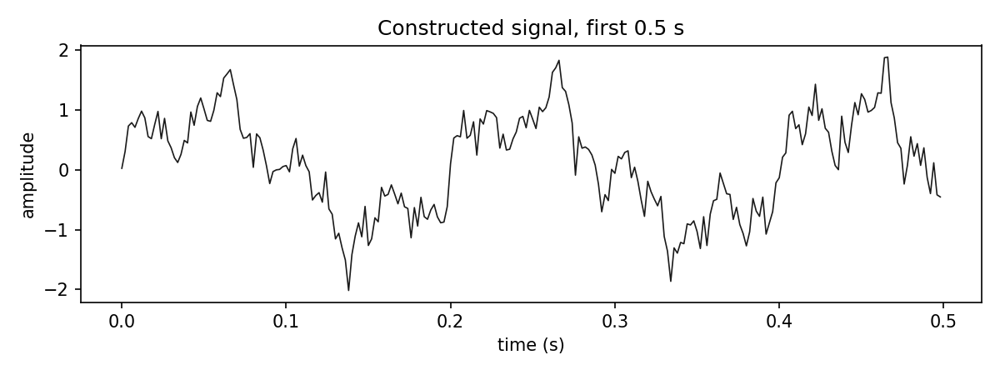

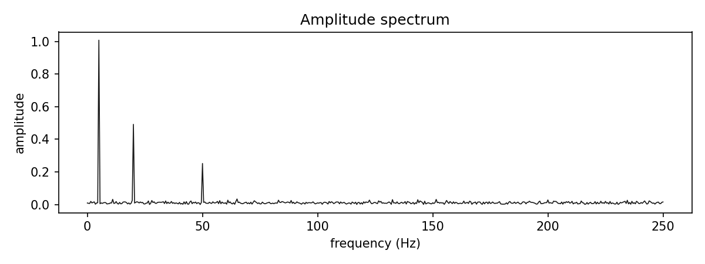

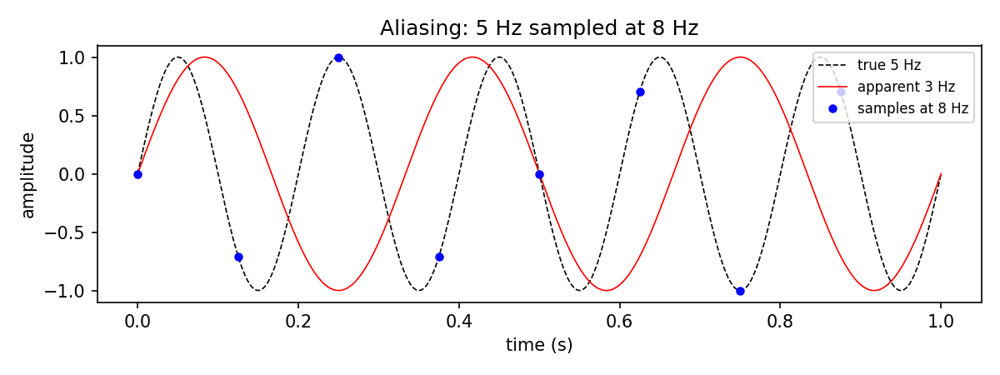

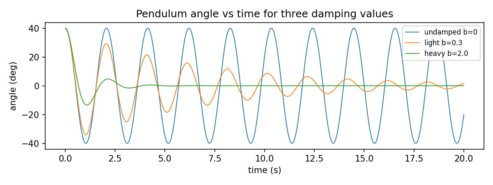

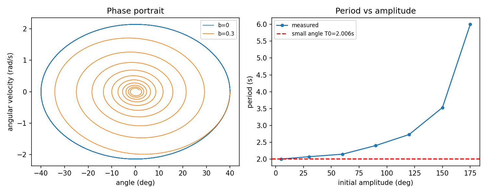

## 1.9 Observations to record

fs, N, T, df, fs/2, measured peak frequencies and amplitudes, aliased peak frequency (3 Hz), T0, period by zero crossings and by spectrum, damping coefficients used (0, 0.3, 2.0).

## 1.10 Applications

Spectral analysis for machine diagnosis; aliasing sets sampling rates of encoders, IMUs and LiDAR; numerically integrated second-order systems model flexible joints.

## 1.11 Questions and answers

Q1. How do you know a 5 Hz peak is not a 45 Hz component aliased down?
A: Check the sampling rate and Nyquist. With fs = 500 Hz, Nyquist = 250 Hz, so 45 Hz is representable directly. Aliasing would only fold if fs < 2*f. Also verify by resampling at a higher rate; a genuine 5 Hz stays, an aliased one moves.

Q2. What sets frequency resolution, and why does sampling faster not improve it?
A: df = 1/T depends only on record length T. Sampling faster raises Nyquist but not resolution.

Q3. Why must the derivative function take (t, y) and not (y, t)?
A: solve_ivp calls f(t, y); the contract requires t first. Passing (y, t) swaps arguments and breaks integration.

Q4. What does the area enclosed by a closed phase-portrait trajectory represent?
A: Action/energy integral; for a conservative oscillator it is proportional to the energy of the motion (2*pi*E/omega).

Q5. Why does the period diverge as the initial angle approaches 180 degrees?
A: The restoring torque sin(theta) -> 0 near the unstable equilibrium, so the bob spends a long time near the top; the integral for the period diverges logarithmically.

## 1.12 Conclusion

The DFT correctly recovered the three component frequencies and amplitudes from a noisy signal, and aliasing was demonstrated and explained. Numerical integration of the pendulum showed the period rising with amplitude, diverging near 180 degrees, matching theory.


# Experiment 2: The eight queens problem

## 2.1 Aim

To formulate the eight queens problem as a constraint satisfaction problem, solve it by generate-and-test and by backtracking, and measure the effect of representation and search strategy on cost.

## 2.2 Objectives

1. State a problem as variables, domains and constraints.
2. Show how encoding removes classes of conflict before search.
3. Implement generate-and-test and measure its cost.
4. Implement backtracking with pruning and count nodes.
5. Compare empirically over a range of board sizes.

## 2.3 Place in the syllabus

Unit I: PEAS formulation. Unit II: backtracking as systematic search, pruning as in A*. Unit V: constraint satisfaction. Contributes to CO1.

## 2.4 Requirements

Python standard library; Matplotlib for plots.

## 2.5 Theory

CSP: variables, domains, constraints. Naive 64^8; column-as-variable gives 8^8; permutation encoding gives 8! = 40320. Diagonal conflict: |ri-rj| = |i-j|.

## 2.6 Method

1. Write conflict counter for a board (one row per column).
2. Enumerate permutations, keep zero-conflict, time it.
3. Write safety test examining only filled columns.
4. Recursive backtracking solver with undo.
5. Count nodes; confirm same solution counts.
6. Repeat n = 4..10; tabulate.

## 2.7 Procedure and code

Run `exp02-queens/exp02.py`.

```python
def is_safe(board, col, row):
    for c in range(col):
        if board[c] == row or abs(board[c]-row) == abs(c-col):
            return False
    return True
```

## 2.8 Results

Table 2.1: Measured on one laptop run.

| n | Solutions | Nodes visited | Backtracking (s) | Generate and test (s) |
|---|---|---|---|---|
| 4 | 2 | 60 | 0.0000 | 0.0000 |
| 5 | 10 | 220 | 0.0001 | 0.0002 |
| 6 | 4 | 894 | 0.0002 | 0.0012 |
| 7 | 40 | 3584 | 0.0009 | 0.0105 |
| 8 | 92 | 15720 | 0.0045 | 0.1028 |
| 9 | 352 | 72378 | 0.0228 | 1.1589 |
| 10 | 724 | 348150 | 0.1122 | 13.9624 |

For n=8 backtracking visits 15720 nodes and finds 92 solutions in ~4.5 ms; generate-and-test needs ~103 ms.

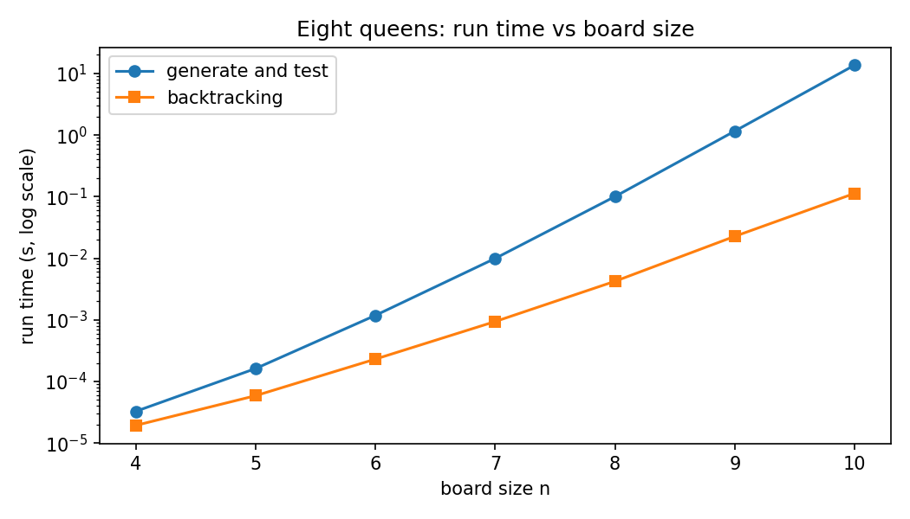

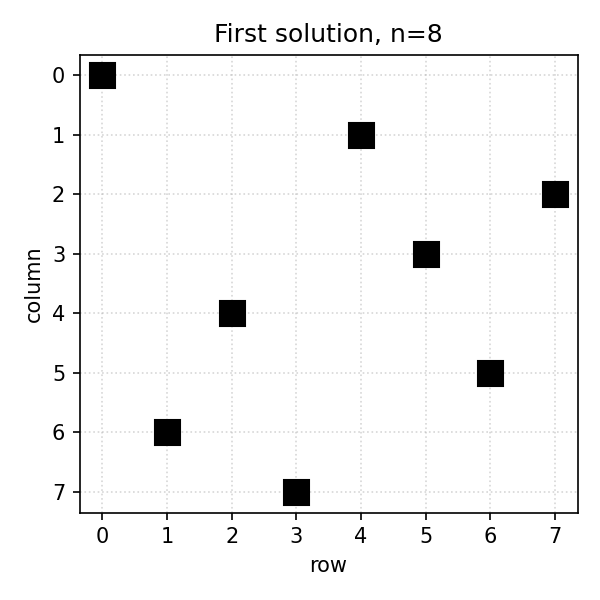

## 2.9 Observations to record

For each n: number of solutions, nodes visited, run time of both methods. First solution for n=8: (0,4,7,5,2,6,1,3).

## 2.10 Applications

Timetabling, register allocation, sudoku, frequency assignment; task allocation across a robot fleet.

## 2.11 Questions and answers

Q1. Using a list of eight row indices, which conflicts become impossible by construction, and which do not?
A: Column and row conflicts become impossible (permutation enforces one per row/column). Diagonal conflicts remain and must be tested.

Q2. Solver reports 2113 solutions instead of 92. What single character is wrong, and where?
A: The undo line `board[col] = -1` is missing, so stale rows carry into sibling branches.

Q3. Why does is_safe examine only columns to the left?
A: Columns to the right are still empty; only placed queens can attack.

Q4. Backtracking is exponential in worst case. Why is it nonetheless right here?
A: Pruning cuts most branches early; the effective search is far smaller than 8!.

Q5. Why do 92 solutions reduce to 12 fundamental ones, not 96?
A: Under 8 symmetries of the square, 92/8 ~ 11.5; one solution is symmetric under 180° rotation, giving 4 images instead of 8, so 12 distinct fundamentals.

## 2.12 Conclusion

Backtracking with pruning solved the same problem as generate-and-test with the same solution counts but far fewer nodes, and the gap grew with board size, confirming pruning's value.


# Experiment 3: Breadth-first and depth-first search

## 3.1 Aim

To represent a maze as an implicit graph, implement BFS and DFS as one function differing in a single line, and compare cells expanded and path length.

## 3.2 Objectives

1. Model a grid as a graph with on-demand edges.
2. Implement frontier, explored set, parent map.
3. Show the only difference is the end of the frontier used.
4. Reconstruct and validate a path.
5. Measure the trade-off between cells expanded and path length.

## 3.3 Place in the syllabus

Unit II: closed-form path planning, BFS as simplest complete instance, base case for A*. Unit III: configuration space. Unit VI: ROS navigation on occupancy grids. Contributes to CO1, CO3.

## 3.4 Requirements

Python with NumPy, Matplotlib; collections.deque.

## 3.5 Theory

Search problem: state space, start, goal test, successor function. Frontier + explored set. BFS removes oldest (FIFO) -> shortest path (same edge cost). DFS removes newest (LIFO) -> no optimality guarantee; memory O(bm) vs O(b^d).

## 3.6 Method

1. Build maze grid with guaranteed path.
2. Neighbour generator: bounds first, then contents.
3. One search function with mode switch.
4. Record expansion order.
5. Reconstruct path via parent map; validate.
6. Plot expansion order; compare.

## 3.7 Procedure and code

Run `exp03-search/exp03.py`. Key line: `node = frontier.popleft() if mode == 'bfs' else frontier.pop()`.

## 3.8 Results

Table 3.1: Measured on the carved maze (23 x 35, 373 open cells).

| Algorithm | Cells expanded | Path length | Shortest? |
|---|---|---|---|
| BFS | 101 | 89 | yes, guaranteed |
| DFS | 89 | 89 | no |

Both paths validated: every step adjacent and clear of walls.

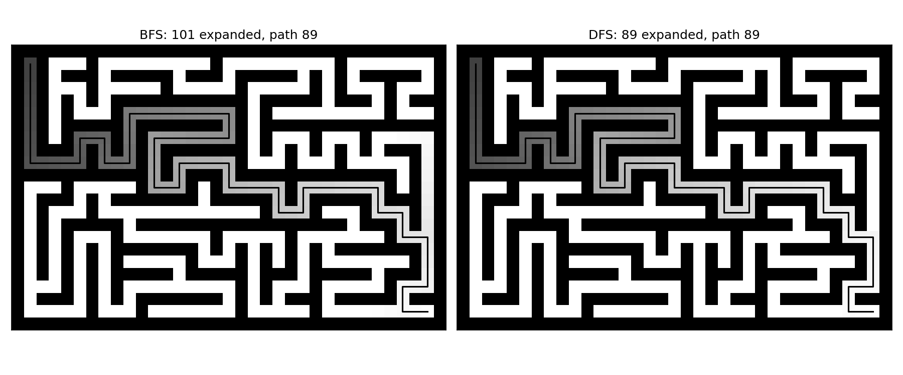

## 3.9 Observations to record

Maze dimensions and open cells; cells expanded and path length for both; validation result.

## 3.10 Applications

Shortest-hop routing, wavefront planner on occupancy grids; topological sorting, cycle detection, maze carving.

## 3.11 Questions and answers

Q1. DFS path 97 and BFS 81: what can you conclude, and what can you not?
A: BFS is optimal (shortest) by guarantee. DFS's path being longer is expected but not proof that DFS always loses; a different goal placement could make DFS expand more or fewer cells.

Q2. Why must the bounds check come before the wall check?
A: Negative indices wrap around in NumPy, so checking contents first can read a valid cell through a wall silently.

Q3. Why mark a cell when enqueued rather than expanded?
A: To prevent the same cell entering the frontier multiple times, keeping complexity polynomial.

Q4. State space complexity of each; which on a memory-constrained robot?
A: BFS O(b^d) time/space; DFS O(bm) space. Choose DFS when memory is tight and optimality is not required.

Q5. If diagonal moves were allowed, would BFS still return a shortest path? Justify.
A: Yes, if all moves (including diagonals) have equal cost; BFS guarantees shortest path in unweighted graphs. If diagonal cost differs (sqrt2), use Dijkstra/A*.

## 3.12 Conclusion

BFS guaranteed the shortest path; DFS expanded fewer cells here but gave no optimality guarantee. The trade-off is between completeness/optimality (BFS) and memory (DFS).

---

# Experiment 4: Hill climbing

## 4.1 Aim

To implement hill climbing as local search, observe failure on local optima, plateaus and ridges, and measure improvement from random restarts.

## 4.2 Objectives

1. Distinguish systematic search (frontier) from local search (one state).
2. Implement steepest-ascent hill climbing on a continuous function and on eight queens.
3. Identify three ways hill climbing gets stuck.
4. Measure success rate and show random restarts' effect.

## 4.3 Place in the syllabus

Unit II: local search, potential-field local minima; optimality and constraints. Unit IV: gradient descent. Contributes to CO1.

## 4.4 Requirements

Python with NumPy, Matplotlib; conflict counter from Exp 2.

## 4.5 Theory

Local search keeps one state; memory constant, completeness lost. Steepest-ascent: evaluate all neighbours, move to best, stop when none better. Fails: local maximum, plateau (shoulder/flat), ridge. Random restarts: k runs succeed with probability 1-(1-p)^k.

## 4.6 Method

1. Plot 1D function with several local maxima.
2. Implement hill climbing on eight-queens objective (minimise conflicts).
3. Run from many random starts; record success rate.
4. Wrap in random-restart loop; repeat for several restart counts.
5. Plot success rate vs restarts; compare with 1-(1-p)^k.

## 4.7 Procedure and code

Run `exp04-hillclimb/exp04.py`.

## 4.8 Results

Table 4.1: Measured over 200 random starts per row, n=8. Plain success p = 12.5%.

| Restarts | Success rate | Predicted 1-(1-p)^k |
|---|---|---|
| 1 | 14.5% | 12.5% |
| 2 | 25.5% | 23.4% |
| 5 | 56.0% | 48.7% |
| 10 | 78.0% | 73.7% |
| 20 | 97.5% | 93.1% |

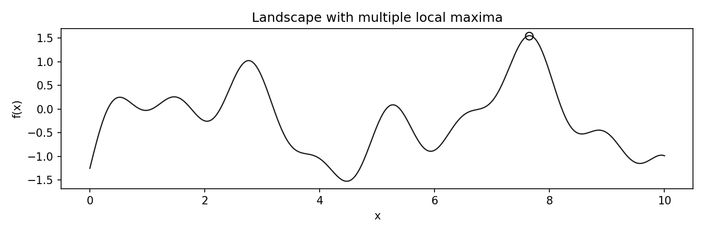

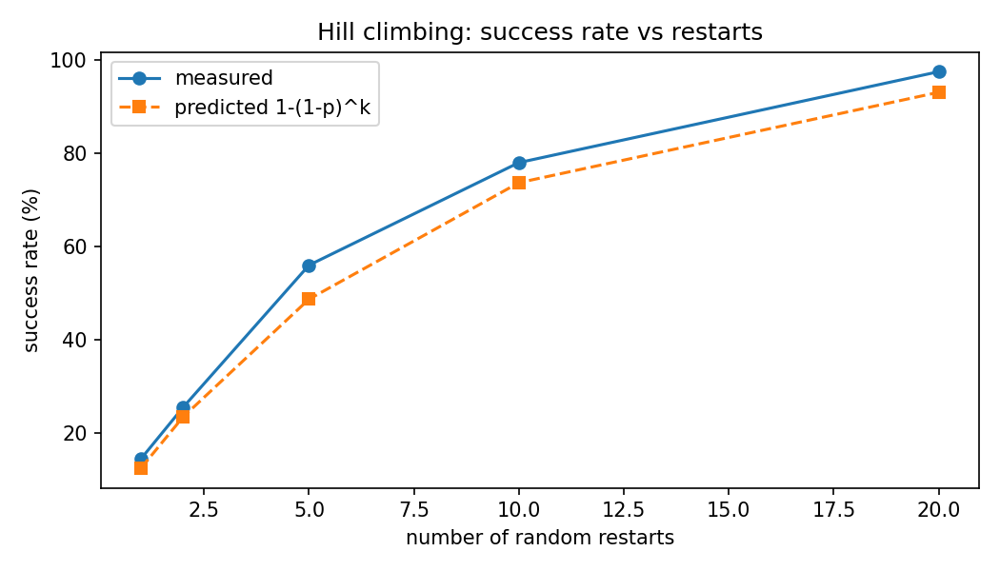

## 4.9 Observations to record

Success rate of plain hill climbing over >=200 starts; success rate at each restart count; comparison with prediction; number of trials beside every percentage.

## 4.10 Applications

Large scheduling/layout problems; randomized gradient descent out of potential-field minima; SGD with multiple initialisations.

## 4.11 Questions and answers

Q1. State the three ways hill climbing gets stuck, and say which sideways moves can fix.
A: Local maximum (no fix by sideways), plateau/shoulder (sideways moves can escape a shoulder but not a flat maximum), ridge (needs diagonal moves). Sideways moves fix shoulders only.

Q2. Why does hill climbing use constant memory when backtracking does not?
A: It keeps one state, not a frontier/recursion stack of exponential size.

Q3. Success rate 15.5% (12.5% here). How many restarts for 99% success, and what assumption?
A: k = ln(0.01)/ln(1-p) ~ ln(0.01)/ln(0.875) ~ 34. Assumes independent restarts.

Q4. Hill climbing starts with a complete board; backtracking builds column by column. Which is better for n=1000, and why?
A: Hill climbing is better for huge n: it uses constant memory and can find a solution quickly; backtracking's exponential memory/time is infeasible.

Q5. 12.5% on one run and 15.5% on another. Is the program wrong? Justify.
A: No: with 200 trials sampling error is a few percent; both estimates are consistent.

## 4.12 Conclusion

Plain hill climbing succeeded ~12.5% of the time; random restarts raised success to 97.5% at 20 restarts, tracking the independence prediction.


# Experiment 5: Reinforcement learning

## 5.1 Aim

To formulate a navigation task as a Markov decision process, implement Q-learning on a grid world, and measure the effect of exploration rate on what is learned and how quickly.

## 5.2 Objectives

1. State a task as states, actions, transitions, rewards.
2. Implement tabular Q-learning and explain each term.
3. Show why exploration is necessary and its cost.
4. Extract and display a policy from the Q table.

## 5.3 Place in the syllabus

Unit I: learning agent. Unit IV: ML concepts, RL as third branch. Unit II: learned policy as feedback controller. Contributes to CO1.

## 5.4 Requirements

Python with NumPy, Matplotlib.

## 5.5 Theory

MDP: states s, actions a, transitions, rewards r. Q-learning update: Q(s,a) <- Q(s,a) + alpha [ r + gamma max_a' Q(s',a') - Q(s,a) ]. TD error in brackets. Off-policy via max. Epsilon-greedy exploration. Step cost -0.1 makes agent prefer short routes.

## 5.6 Method

1. Define grid world with walls, goal +10, pit -10, step cost -0.1.
2. Initialise Q to zero.
3. For each episode, act epsilon-greedy, update after every step, stop at terminal or step cap (120).
4. Record total reward per episode.
5. Repeat for several epsilon; plot smoothed learning curves.
6. Extract greedy policy; draw arrows.

## 5.7 Procedure and code

Run `exp05-rl/exp05.py`.

## 5.8 Results

Table 5.1: Mean return over final 100 episodes of a 600-episode run.

| epsilon | Mean return, last 100 | Interpretation |
|---|---|---|
| 0.05 | 8.86 | Learns well; slowest to discover goal at first |
| 0.20 | 8.86 | Same final quality, faster early progress |
| 0.50 | 7.44 | Same policy learned, but acts randomly half the time |

Extracted policy (epsilon=0.20) routes around the pit to the goal.

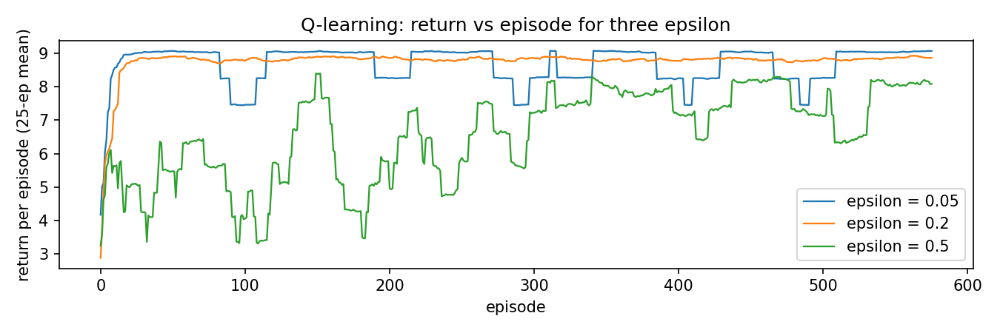

## 5.9 Observations to record

Grid dimensions, reward structure, alpha, gamma, episodes, mean return over last 100 for each epsilon, extracted policy grid.

## 5.10 Applications

Robot locomotion gaits, manipulation policies in simulation, data-centre cooling, traffic signals. Tabular Q-learning does not scale; DQN replaces the table.

## 5.11 Questions and answers

Q1. Explain each term of the Q-learning update, and say what the bracket represents.
A: alpha learning rate; r immediate reward; gamma discount; max_a' Q(s',a') best future value. The bracket is the TD error: observed minus expected.

Q2. Why must the future-value term be dropped at a terminal state?
A: At terminal there is no future; keeping gamma*max Q makes the agent value states beyond the episode end and values diverge.

Q3. The epsilon=0.5 agent earns less. Has it learned a worse policy? Justify.
A: No: its greedy policy is essentially the same; it only acts randomly half the time, so earned return is lower.

Q4. Purpose of -0.1 reward per step? What happens without it?
A: It makes the agent prefer short routes. Without it, every path reaching the goal scores the same, so no urgency.

Q5. Q-learning is off-policy. What does that mean, and why does it permit exploration?
A: It learns the value of the best (greedy) action while behaving epsilon-greedily; the max decouples learning from behaviour, so exploration does not corrupt the target.

## 5.12 Conclusion

All three epsilon values learned a good policy; higher epsilon lowered earned return without worsening the learned policy, illustrating the distinction between learned policy and exhibited behaviour.

---

# Experiment 6: A simple neural network

## 6.1 Aim

To implement a two-layer neural network in NumPy alone, train it on XOR by backpropagation, and observe the effect of learning rate on convergence.

## 6.2 Objectives

1. Show why a single linear unit cannot represent XOR.
2. Implement forward pass, loss, backpropagation, gradient descent without a framework.
3. Train to convergence and verify the learned function.
4. Measure learning-rate effect and visualise the decision boundary.

## 6.3 Place in the syllabus

Unit IV: ML concepts, supervised branch. Unit IV: gradient descent as hill climbing on a differentiable landscape. Unit V: inductive vs knowledge-based learning. Contributes to CO1.

## 6.4 Requirements

Python with NumPy, Matplotlib. No ML framework.

## 6.5 Theory

Single linear unit cannot separate XOR (not linearly separable). Hidden layer re-represents input. Network: h = sigmoid(W1 x + b1), o = sigmoid(W2 h + b2). Loss E = mean (o-y)^2. Deltas: do = (o-y) o(1-o); dh = (do W2^T) h(1-h). Weights must be initialised randomly (zero init makes hidden units identical).

## 6.6 Method

1. Write four XOR pairs.
2. Initialise weights randomly (seeded), biases zero.
3. Implement forward pass and loss.
4. Derive and implement deltas and gradients.
5. Update by gradient descent; record loss per epoch.
6. Repeat for several learning rates; plot on log axis.
7. Evaluate on dense grid; plot decision boundary.

## 6.7 Procedure and code

Run `exp06-neural/exp06.py`.

## 6.8 Results

Table 6.1: Final MSE after 20000 epochs, 4 hidden units, seed 1.

| Learning rate | Final MSE | Behaviour |
|---|---|---|
| 0.05 | 2.31e-03 | Still descending; not converged |
| 0.50 | 1.11e-04 | Converged |
| 2.00 | 2.46e-05 | Converged fastest, no instability |
| 10.00 | 5.81e-06 | Converged (tiny problem only) |

Predictions at lr=2.0: [0.004, 0.995, 0.996, 0.006] (XOR). lr=10.0 would diverge on larger networks.

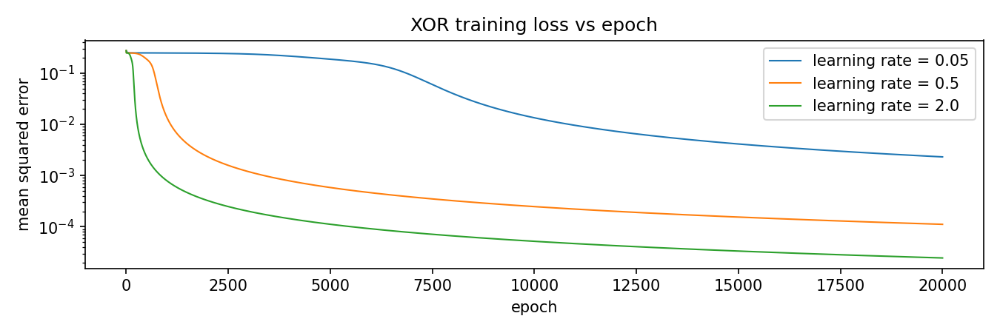

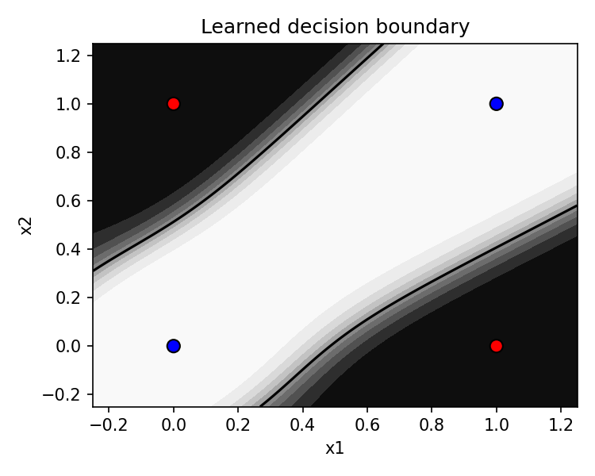

## 6.9 Observations to record

Network shape, init seed, learning rates tried, loss curve per rate, final MSE, four predicted outputs rounded to 3 decimals, convergence statement.

## 6.10 Applications

Object recognition on a robot camera, learned inverse kinematics, value approximators replacing Q-tables.

## 6.11 Questions and answers

Q1. Why can a single linear unit not represent XOR? What does the hidden layer change?
A: XOR is not linearly separable; no single line splits (0,0),(1,1) from (0,1),(1,0). The hidden layer re-represents input in a space where it becomes separable.

Q2. What goes wrong if all weights are initialised to zero, and why?
A: All hidden units compute identically and receive identical gradients, staying identical forever; the network reduces to a single unit and cannot learn XOR.

Q3. Where does o(1-o) come from in the output delta?
A: It is the derivative of the sigmoid: sigma'(z) = sigma(z)(1-sigma(z)), expressed via the activation o.

Q4. Loss flat for thousands of epochs then falls sharply. What is happening?
A: The network sits near the symmetric initial solution before hidden units differentiate; once symmetry breaks, learning accelerates.

Q5. Which earlier experiment is gradient descent a continuous version of, and what failure mode do they share?
A: Hill climbing (Exp 4); both can get stuck in local minima.

## 6.12 Conclusion

The two-layer network learned XOR from random init; learning rate strongly affected convergence speed, with lr=2.0 fastest and stable on this tiny problem.


# Experiment 7: Webots: Reactive swarm and Lidar navigation

## 7.1 Aim

To study reactive control: Braitenberg obstacle avoidance in a multi-robot swarm and follow-the-gap LiDAR navigation, measuring coverage, stuck time and safety.

## 7.2 Objectives

1. Implement and run a Braitenberg vehicle swarm in Webots.
2. Measure coverage and stuck percentage vs parameters.
3. Implement follow-the-gap navigation with a SICK LMS 291.
4. Relate safety bubble size to robot width.
5. Explain why reactive controllers loop and how to escape.

## 7.3 Place in the syllabus

Unit II/III: reactive vs deliberative control, configuration space. Contributes to CO1, CO3.

## 7.4 Requirements

Webots R2025a, Python 3; matplotlib, numpy for plots.

## 7.5 Theory

Braitenberg: sensor readings scaled 0-1 drive wheels via mirror-image weights; obstacle on right slows left wheel and speeds right wheel -> turn left. Follow-the-gap: clip scan, mark free beams, cut safety bubble around closest obstacle, find widest gap, steer to its middle; speed from front distance. Reactive control has no memory -> loops.

## 7.6 Method

1. Open/run swarm_arena.wbt; logger records 120 s.
2. Run headless with run_experiment.py; vary parameters.
3. Plot trajectories and coverage.
4. Run pioneer_lidar.wbt; vary bubble, k_turn etc.
5. Record metrics.

## 7.7 Procedure and code

Run in `/exp07-webots/code`: `python tools/run_experiment.py swarm --seconds 120` and `... pioneer --seconds 180`. Code stored under `exp07-webots/code`.

## 7.8 Results

Table 7.1: Swarm metrics (120 s, 5 e-pucks).

| Run | Mean path/robot (m) | Worst stuck | Coverage |
|---|---|---|---|
| default (cruise 0.5) | 6.4 | 2.7% | 75% |
| cruise = 0.9 | 9.2-10.4 | 75.7% (one robot wedged) | 89% |
| cruise = 0.2 | 2.7 | 0.3% | 55% |
| gain = 1 | 6.4 | 5.1% | 77% |
| gain = 10 | 6.5 | 1.9% | 82% |
| speed = 0.5 | 3.4 | 0.5% | 61% |
| noise = 0.3 | 6.4 | 2.1% | 74% |

Our run (default): e-pucks 6.08-6.68 m, stuck 0.5-2.7%, coverage 75%. cruise=0.9: coverage 89%, e-puck3 stuck 75.7%.

Table 7.2: Pioneer metrics (180 s).

| Run | Distance (m) | Stuck | Coverage |
|---|---|---|---|
| default | 83.6 | 0% | 23% |
| bubble = 0.15 | 13.4 | 77.4% | 12% |
| bubble = 0.9 | 79.8 | 0% | 24% |
| k_turn = 0.5 | 74.3 | 0% | 29% |
| stop = 0.8 | 10.9 | 85% | 11% |

Our runs match: default 83.60 m, 0% stuck, 23% coverage; bubble=0.15 13.40 m, 77.4% stuck, 12% coverage.

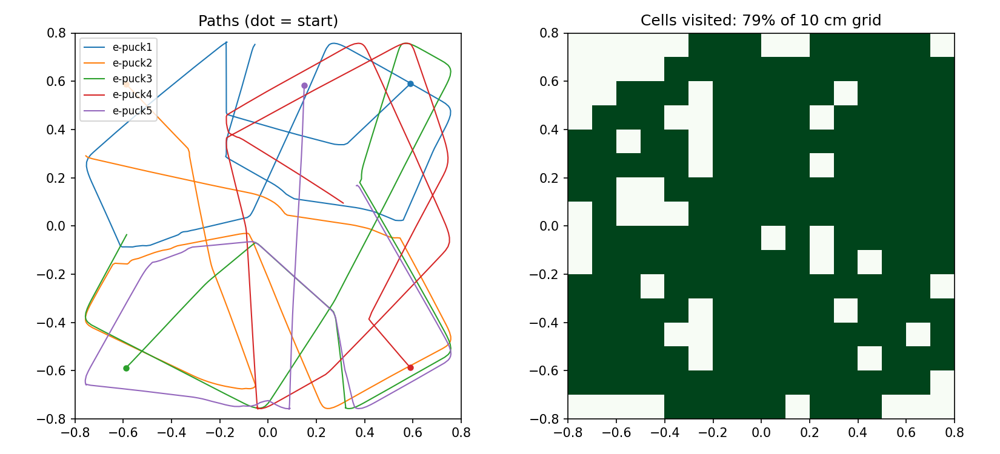

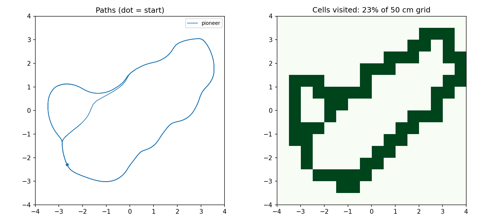

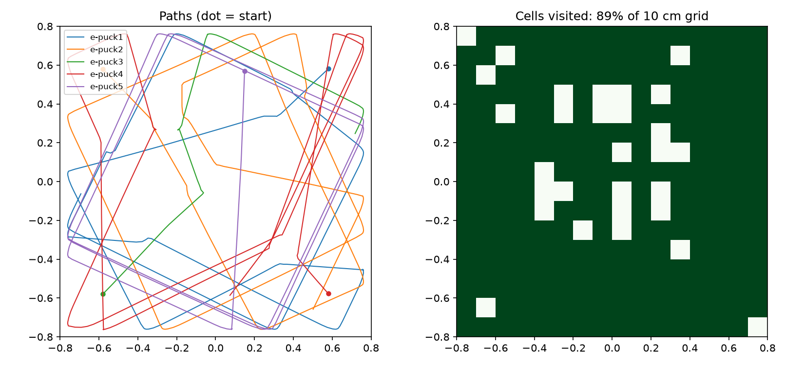

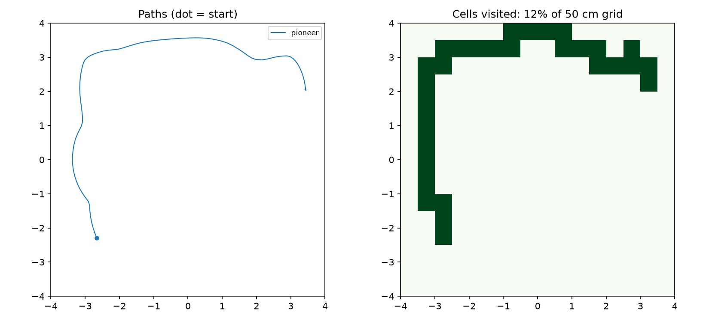

## 7.9 Observations to record

Per-run: path m, mean m/s, stuck %, coverage %. Parameters changed and effect.

## 7.10 Applications

Autonomous racing (F1TENTH follow-the-gap), warehouse AGVs, exploration robots.

## 7.11 Questions and answers

Q1. What is an embodiment gap? (Webots: sensor range vs robot speed.) Not applicable; viva Qs for Webots are from the guide's exercises. Key: Why does a reactive controller loop? Because it has no memory of visited cells. How to escape? Add randomness, prefer unvisited gaps, or keep a coarse visited grid.

Q2. Safety margin must match robot width: Pioneer is 0.38 m wide; a 0.15 m bubble is a bug.

Q3. Parameters interact: max_v and lookahead did little alone because slow*front was the active limit.

## 7.12 Conclusion

Reactive Braitenberg swarm covered 75% of the arena at default speed with low stuck time; raising cruise to 0.9 raised coverage to 89% but wedged one robot. The Pioneer never collided but looped, covering only 23%; a too-small safety bubble caused 77% stuck time.


# Experiment 8: Cross-embodiment transfer in PyBullet

## 8.1 Aim

To study whether a pick-and-place skill developed on one robot arm transfers to arms with different kinematics, joint counts and sizes, and to identify which design choices make transfer succeed or fail.

## 8.2 Objectives

1. Describe embodiment via measurable quantities (DOF, limits, reach, workspace).
2. Explain why copying joint angles does not transfer.
3. Use shared task-space action space and IK adapter.
4. Train behaviour-cloning policy and test zero-shot on unseen robots.
5. Explain observation choice (task-space vs joint angles) effect.
6. Separate interface problem from capability problem.

## 8.3 Place in the syllabus

Unit II/III: kinematics, configuration space, planning. Contributes to CO1, CO3.

## 8.4 Requirements

Python 3.10/3.11, PyBullet, NumPy, Matplotlib, scikit-learn. See `exp08-xembody/code`.

## 8.5 Theory

Embodiment: DOF, link lengths, limits, gripper, mount. Embodiment gap: action-space, observation, dynamics, capability. Joint space vs task space: same q gives different poses; same desired x can be sent to any robot with IK. Shared interface: obs = [tool xyz, holding, cube xyz, goal xyz] (10), action = [dx,dy,dz,grip] (4). BC on (obs, expert action) pairs; DART noise injection. Multi-embodiment training.

## 8.6 Method

Parts 0-5 per manual: setup check, measure bodies, joint-space replay, task-space transfer, learn on KUKA deploy on all, leave-one-embodiment-out.

## 8.7 Procedure and code

Run in `exp08-xembody/code`: experiments 00..05. Code stored under `exp08-xembody/code`.

## 8.8 Results

Table 8.1: Embodiments.

| Robot | Arm DOF | Max reach (m) | Task coverage |
|---|---|---|---|
| kuka_iiwa | 7 | 0.945 | 100% |
| franka_panda | 7 | 0.944 | 100% |
| xarm6 | 6 | 0.759 | 100% |
| kuka_mini | 7 | 0.662 | 47.8% |

Table 8.2: Joint-space replay of KUKA trajectories (10 episodes).

| Robot | Success | Mean path dev (cm) | Median cube-goal err (cm) |
|---|---|---|---|
| kuka_iiwa | 100% | 1.42 | 0.05 |
| franka_panda | 0% | 16.7 | 29.2 |
| xarm6 | 0% | 27.2 | 34.3 |
| kuka_mini | 0% | 17.6 | 34.3 |

Table 8.3: Task-space transfer of expert (20 episodes).

| Robot | Success | Mean steps | Median cube-goal err (cm) |
|---|---|---|---|
| kuka_iiwa | 100% | 50.5 | 0.15 |
| franka_panda | 100% | 46.6 | 0.13 |
| xarm6 | 100% | 44.9 | 0.27 |
| kuka_mini | 30% | 43.8 | 1.54 |

Table 8.4: Learn on KUKA, deploy everywhere (60 demos, 20 test episodes).

| Robot | Expert | BC-agnostic | BC-proprio |
|---|---|---|---|
| kuka_iiwa | 100% | 100% | 100% |
| franka_panda | 100% | 100% | 0% |
| xarm6 | 100% | 100% | 0% |
| kuka_mini | 50% | 55% | 0% |

Table 8.5: Leave-one-embodiment-out (60 demos per policy).

| Unseen robot | single, agnostic | multi, agnostic | single, proprio | multi, proprio |
|---|---|---|---|---|
| kuka_iiwa | 100% | 100% | 0% | 0% |
| franka_panda | 100% | 100% | 0% | 5% |
| xarm6 | 100% | 100% | 0% | 0% |

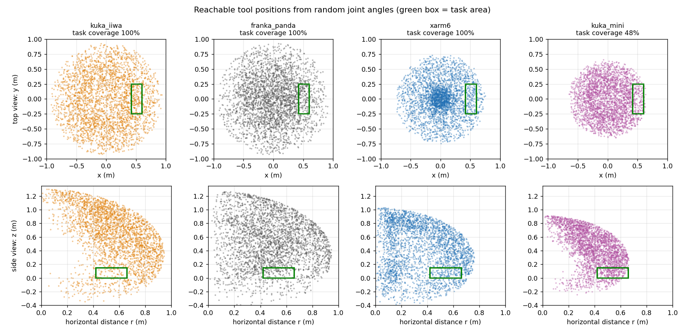

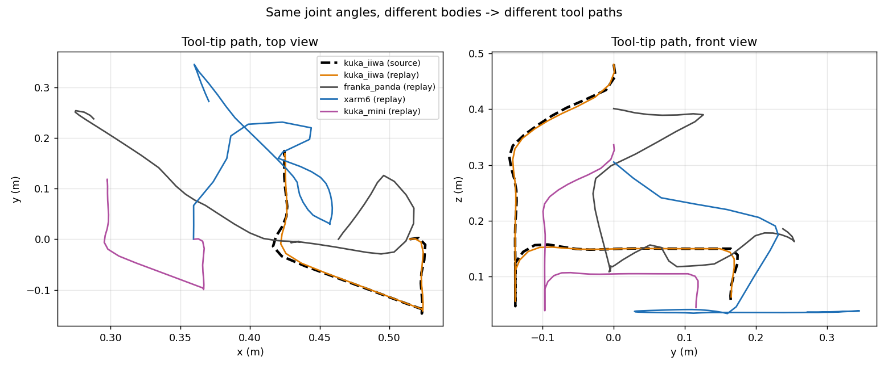

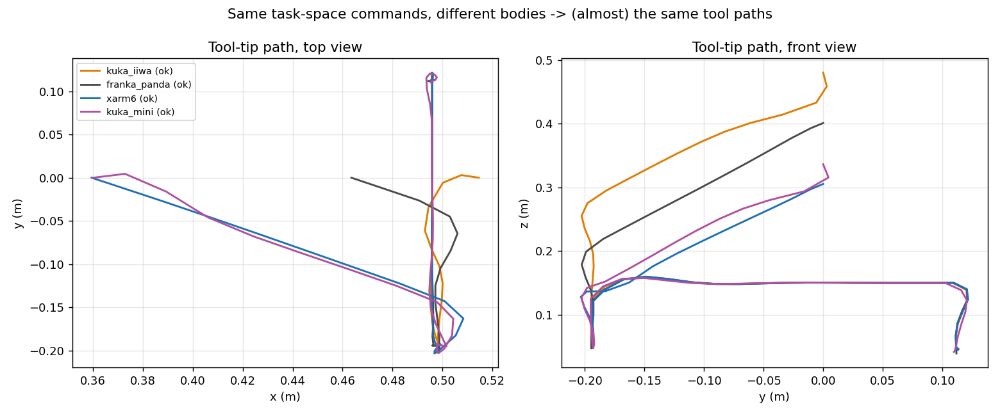

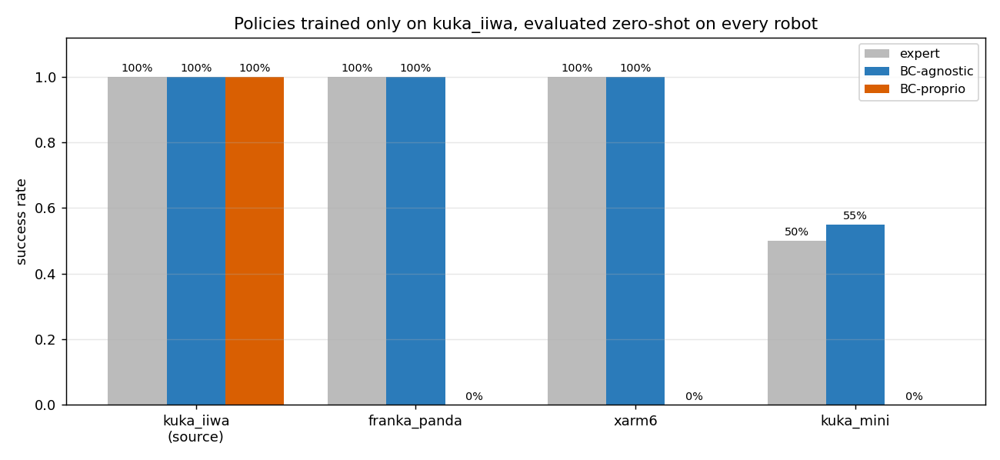

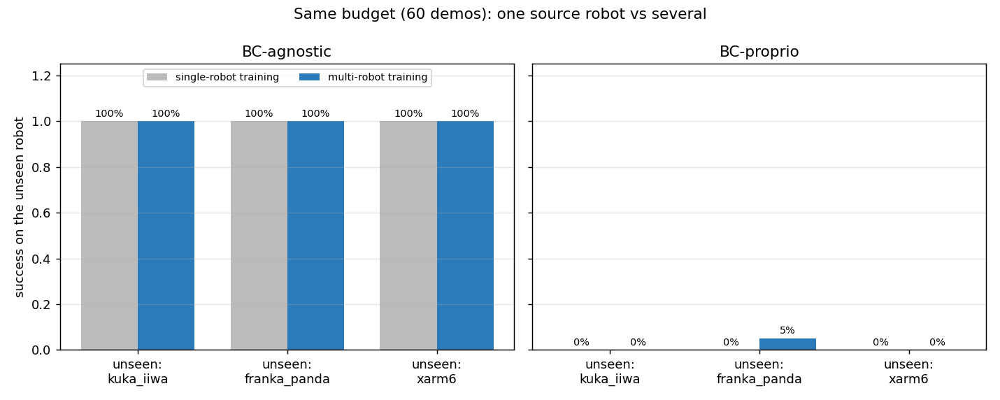

## 8.9 Observations to record

DOF, max reach, task coverage; joint-space replay metrics; task-space transfer metrics; BC success rates; leave-one-out success rates.

## 8.10 Applications

Cross-embodiment datasets (Open X-Embodiment), RT-X/Octo/CrossFormer/HPT generalist policies.

## 8.11 Questions and answers

Q1. Why does joint-space replay fail on kuka_mini, which has the same joints and angles?
A: Identical angles with shorter links trace a shrunken copy of the path; the tool never reaches the task area. Capability gap: the body cannot reach.

Q2. Panda and KUKA both have 7 joints. Why is same DOF not enough?
A: Link lengths/offsets differ and joint 4 of Panda bends one way only; same q maps to different tool poses (action-space gap beyond count).

Q3. In task-space transfer, which robot still fails, and is it interface, policy or body?
A: kuka_mini (30%). Body: task coverage only 48%; interface and policy are fine (expert itself fails similarly).

Q4. In Part 4, BC-agnostic vs BC-proprio trained on identical data; explain difference on other robots via observation gap.
A: BC-proprio includes joint angles, which are body-specific; the policy depends on the source body and fails to transfer. BC-agnostic uses only task-space features, so it transfers.

Q5. On kuka_mini, BC-agnostic and expert score almost the same. Why is body, not policy, the limit? Why can they still differ by an episode?
A: Both are limited by reach; near the reachable boundary a slightly different path decides success, so 55% vs 50%.

Q6. In Part 5, does multi-embodiment training help BC-proprio? Does it matter for BC-agnostic? Why?
A: Multi training does not rescue BC-proprio (0-5%): two bodies too few to learn to ignore joint angles. BC-agnostic already transfers from one body; multi mainly reduces placement error.

Q7. Suction gripper hides gripper differences. Name two things that make a real two-finger gripper harder to transfer.
A: Grasp pose/orientation dependence and gripper-specific contact dynamics/friction.

Q8. Suggest one way to make kuka_mini succeed without changing the policy.
A: Move its base closer to the task (e.g. base_pos=(0.15,0,0)) or scale it up, increasing reach.

## 8.12 Conclusion

A skill in joint space did not transfer even between same-DOF arms. Task-space interface with per-robot IK let a policy trained on one robot run on unseen robots. Adding joint angles to observations broke transfer. No interface can transfer to a body that cannot reach the task.


# Appendix A: GitHub repository

All code for this report is stored in the GitHub repository:

`https://github.com/hima-97435/aisr-lab-500121200`

Repository layout:

```
aisr-lab-500121200/
  README.md
  report.pdf
  exp01-signals/   exp01.py, figs/
  exp02-queens/    exp02.py, figs/
  exp03-search/    exp03.py, figs/
  exp04-hillclimb/ exp04.py, figs/
  exp05-rl/        exp05.py, figs/
  exp06-neural/    exp06.py, figs/
  exp07-webots/    code/ (webots project), figs/
  exp08-xembody/   code/ (cross-embodiment project), results, models
```

Commit history documents incremental progress across sessions.

# Appendix B: Sources and AI tools used

Sources:
- Laboratory Manual, Experiments 1-6, CSAI4014, UPES (provided).
- AISR-Cross-Embodiment-PyBullet manual (MANUAL.md) by Dr. Resham Raj Shivwanshi.
- Webots robotics simulation guide (GUIDE.md) and project.
- Russell, S. and Norvig, P., Artificial Intelligence: A Modern Approach, 3rd ed.
- Open X-Embodiment Collaboration, "Open X-Embodiment", IEEE ICRA 2024.
- Laskey et al., "DART", CoRL 2017.
- Coumans, E. and Bai, Y., "PyBullet", pybullet.org.

AI tools:
- Claude (Anthropic) was used to assist in code generation, debugging and drafting of this report. All code was run and verified by the student.

References (IEEE style):
[1] S. Russell and P. Norvig, Artificial Intelligence: A Modern Approach, 3rd ed. Pearson, 2010.
[2] E. Coumans and Y. Bai, "PyBullet, a Python module for physics simulation," pybullet.org, 2016-2024.
[3] Open X-Embodiment Collaboration, "Open X-Embodiment: Robotic Learning Datasets and RT-X Models," IEEE ICRA, 2024.
[4] M. Laskey et al., "DART: Noise Injection for Robust Imitation Learning," CoRL, 2017.
[5] V. Braitenberg, Vehicles: Experiments in Synthetic Psychology. MIT Press, 1984.
[6] Cyberbotics, "Webots R2025a," cyberbotics.com.
